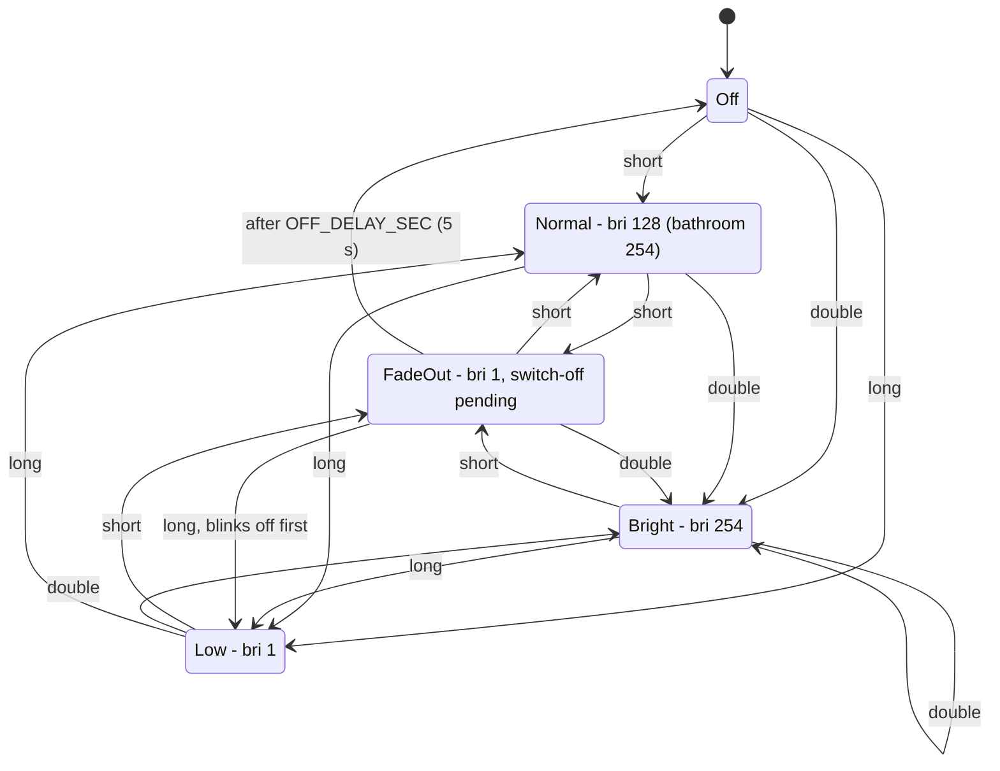

# hue

Controls Philips Hue lights from Zigbee wall switches, using MQTT. The full behaviour is in [specification.md](specification.md).

## Wall switch state machine

This applies to each room on a switch that uses short, double and long presses: the living room (both sides), the left side of the bedroom switch, the bathroom, the hallway and the toilet.

- The normal level of a room is its `normal` value in `config.json`. It defaults to `MID` (128). The bathroom uses `BRIGHT`, so in the bathroom Normal and Bright are the same level.
- The Low and FadeOut states have the same brightness. They differ only in whether a switch-off timer is pending.
- The bedroom right button and the bed light button always send the room to FadeOut. They also toggle the `poster socket`.
